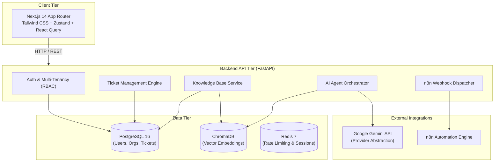

# SupportPilot AI — Intelligent Customer Support Automation Platform

[](https://fastapi.tiangolo.com)
[](https://nextjs.org)
[](https://www.postgresql.org)
[](https://www.docker.com)
[](LICENSE)

SupportPilot AI is a production-oriented multi-tenant SaaS application built for intelligent customer support ticket classification, semantic retrieval-augmented generation (RAG), and workflow automation.

---

## 🏗️ System Architecture



---

## 📁 Monorepo Folder Structure

```
supportpilot/
├── .env.example                    # Global environment configuration template
├── .gitignore                      # Git ignore rules for monorepo
├── Makefile                        # Shortcuts for Docker, tests, and migrations
├── README.md                       # Main documentation & setup guide
├── docker-compose.yml              # Production orchestration (PostgreSQL, Backend, Frontend)
├── docker-compose.dev.yml          # Development override (hot-reload mounts)
│
├── backend/                        # Python FastAPI Backend
│   ├── .env.example                # Backend-specific environment variables
│   ├── Dockerfile                  # Multi-stage production container
│   ├── pyproject.toml              # Build & dependency metadata
│   ├── requirements.txt            # Production dependencies
│   ├── requirements-dev.txt        # Testing and linting dependencies
│   ├── alembic.ini                 # Database migrations configuration
│   └── app/
│       ├── main.py                 # FastAPI application factory & lifespan
│       ├── config.py               # Pydantic BaseSettings configuration
│       ├── dependencies.py         # Injected dependencies (Auth, DB, RBAC)
│       ├── api/
│       │   └── v1/                 # Versioned REST API routers
│       │       ├── auth.py         # Login, register, token refresh
│       │       ├── tickets.py      # Ticket CRUD & status transitions
│       │       ├── knowledge.py    # Document upload & RAG queries
│       │       ├── agents.py       # AI pipeline triggers
│       │       ├── analytics.py    # Metric aggregation
│       │       ├── webhooks.py     # n8n webhook receiver & dispatcher
│       │       └── router.py       # Main API v1 router
│       ├── core/
│       │   ├── exceptions.py       # Custom typed exceptions & handlers
│       │   ├── logger.py           # Structured application logging
│       │   ├── middleware.py       # Rate limiting & request logging
│       │   └── security.py         # bcrypt hashing & JWT tokens
│       ├── db/
│       │   ├── session.py          # Async SQLAlchemy engine & session factory
│       │   ├── seed.py             # Demo organization & ticket seed data
│       │   └── migrations/         # Alembic database migrations
│       │       └── versions/
│       │           └── 001_initial_schema.py  # DDL for all models
│       ├── models/                 # SQLAlchemy ORM models
│       │   ├── base.py             # UUIDMixin & TimestampMixin
│       │   ├── organization.py     # Tenant entity
│       │   ├── user.py             # User accounts & RBAC roles
│       │   ├── ticket.py           # Tickets & thread messages
│       │   ├── knowledge.py        # Document metadata & indexing status
│       │   └── audit_log.py        # Append-only audit trail
│       ├── schemas/                # Pydantic request/response schemas
│       │   ├── auth.py
│       │   ├── ticket.py
│       │   └── knowledge.py
│       ├── services/               # Business logic layer
│       │   ├── auth_service.py
│       │   ├── ticket_service.py
│       │   └── knowledge_service.py
│       └── ai/                     # AI & RAG Subsystem
│           ├── orchestrator.py     # Agent orchestration
│           ├── providers/          # LLM provider abstraction (Gemini)
│           ├── agents/             # Classifier, Retriever, Generator, Evaluator
│           └── rag/                # Ingestion & retrieval pipelines
│
├── frontend/                       # Next.js 14 Frontend Application
│   ├── .env.example                # Frontend environment variables template
│   ├── Dockerfile                  # Multi-stage Next.js standalone container
│   ├── package.json                # Frontend package dependencies
│   ├── tsconfig.json               # TypeScript configuration
│   ├── tailwind.config.ts          # Tailwind CSS styling & brand tokens
│   ├── next.config.ts              # Next.js proxy & compiler settings
│   └── src/
│       ├── app/                    # Next.js App Router
│       │   ├── (auth)/             # Login & Register views
│       │   ├── (dashboard)/        # Protected SaaS layout & views
│       │   │   ├── page.tsx        # Overview dashboard with analytics
│       │   │   ├── tickets/        # Ticket management view
│       │   │   ├── knowledge-base/ # Document ingestion & semantic search
│       │   │   ├── analytics/      # Performance metrics
│       │   │   └── agents/         # AI agent configuration
│       │   └── layout.tsx          # Root layout with providers
│       ├── components/             # Reusable UI components
│       ├── lib/                    # API client (Axios with auto-refresh)
│       ├── store/                  # Zustand state slices (Auth)
│       └── types/                  # TypeScript interface definitions
│
├── n8n/                            # Workflow Automation
│   └── workflows/
│       ├── ticket_created.json     # Workflow for new ticket events
│       ├── ticket_resolved.json    # Workflow for resolution & customer CSAT
│       └── escalation.json         # Workflow for urgent alerting
│
└── nginx/                          # Reverse Proxy (Production)
    └── nginx.conf                  # SSL termination & path-based routing
```

---

## ⚡ Prerequisites

- **Docker & Docker Compose** (v20.10+ & Compose v2.0+)
- **Python 3.11+** (for local backend development)
- **Node.js 18+ & pnpm** (for local frontend development)

---

## 🚀 Quick Start with Docker Compose

1. **Clone the repository and copy environment variables:**
   ```bash
   cp .env.example .env
   ```

2. **Start the complete stack (PostgreSQL, Backend, Frontend):**
   ```bash
   docker compose up --build
   ```

3. **Verify the services:**
   - **Frontend Dashboard:** [http://localhost:3000](http://localhost:3000)
   - **FastAPI Documentation:** [http://localhost:8000/docs](http://localhost:8000/docs)
   - **Backend Health Check:** [http://localhost:8000/health](http://localhost:8000/health)

---

## 🛠️ Local Development (Without Docker)

### 1. Database Setup
Ensure PostgreSQL is running locally, or run just the database via Docker:
```bash
docker run --name supportpilot_pg -e POSTGRES_USER=supportpilot -e POSTGRES_PASSWORD=supportpilot_password -e POSTGRES_DB=supportpilot -p 5432:5432 -d postgres:16-alpine
```

### 2. Backend Setup
```bash
cd backend

# Create virtual environment
python -m venv .venv
# Activate virtual environment:
# On Windows:
.venv\Scripts\activate
# On Linux/macOS:
source .venv/bin/activate

# Install dependencies
pip install -r requirements.txt

# Run migrations
alembic upgrade head

# Seed demo data
python -m app.db.seed

# Start backend dev server
uvicorn app.main:app --host 0.0.0.0 --port 8000 --reload
```

### 3. Frontend Setup
```bash
cd frontend

# Install dependencies
pnpm install

# Start Next.js development server
pnpm dev
```
Open [http://localhost:3000](http://localhost:3000) in your browser.

---

## 🧪 Testing & Verification

### Backend Health Check
```bash
curl http://localhost:8000/health
```
Response:
```json
{
  "status": "healthy",
  "version": "1.0.0",
  "env": "development",
  "service": "supportpilot-backend"
}
```

### Running Test Suites
```bash
# 1. Frontend Linting & Type Checking
cd frontend
pnpm type-check
pnpm lint

# 2. Backend Automated Test Suite (41 tests across AI agents, RAG, Webhooks, Auth, Human Support, Analytics, SaaS Production)
cd backend
python -m pytest -v
```

---

## 🚀 Deployment & Operations

- **100% Free Cloud Deployment:** See [`docs/FREE_DEPLOYMENT_GUIDE.md`](file:///docs/FREE_DEPLOYMENT_GUIDE.md) for deploying with Vercel (Frontend) + Render (Backend) + Supabase (PostgreSQL) with zero monthly cost and no credit card required.
- **Google Cloud Platform (GCP):** See [`docs/GCP_DEPLOYMENT.md`](file:///docs/GCP_DEPLOYMENT.md) for GCE VM, Cloud Storage, Secret Manager, and automated backup deployment.
- **Ubuntu VPS Deployment:** See [`docs/UBUNTU_VPS_DEPLOYMENT.md`](file:///docs/UBUNTU_VPS_DEPLOYMENT.md) for a single-server Docker Compose deployment with Caddy reverse proxy and automatic Let's Encrypt TLS.
- **Database Backup & Disaster Recovery:** See [`docs/BACKUP_AND_RESTORE.md`](file:///docs/BACKUP_AND_RESTORE.md) for automated backup scripts (`scripts/backup_db.sh`), point-in-time recovery, and cloud replication.

---

## 💬 Embeddable Customer Chat Widget

SupportPilot AI includes an embeddable customer chatbot widget that can be embedded into any external website. To install the widget, add the script before `</body>`:

```html
<script 
  src="https://api.yourdomain.com/api/v1/widget/loader.js" 
  data-org-slug="your-org-slug" 
  data-primary-color="#2563eb"
  defer>
</script>
```

---

## 🔑 Environment Variables Reference

| Variable | Description | Default |
|---|---|---|
| `APP_ENV` | Application environment (`development` / `production`) | `development` |
| `LOG_FORMAT` | Log format (`text` / `json`) | `text` (auto `json` in prod) |
| `SECRET_KEY` | 32+ character key for JWT signature | Must be set |
| `DOMAIN_APP` | Domain for Next.js frontend | `app.localhost` |
| `DOMAIN_API` | Domain for FastAPI backend | `api.localhost` |
| `DOMAIN_N8N` | Domain for n8n workflow engine | `n8n.localhost` |
| `ACME_EMAIL` | Contact email for Let's Encrypt SSL certificates | `admin@supportpilot.dev` |
| `DATABASE_URL` | Async PostgreSQL connection string | `postgresql+asyncpg://...` |
| `DATABASE_URL_SYNC` | Synchronous connection string for Alembic | `postgresql://...` |
| `POSTGRES_USER` | PostgreSQL superuser username | `supportpilot` |
| `POSTGRES_PASSWORD` | PostgreSQL password | `supportpilot_password` |
| `POSTGRES_DB` | PostgreSQL database name | `supportpilot` |
| `NEXT_PUBLIC_API_URL` | Backend URL accessible from frontend | `http://localhost:8000` |
| `GEMINI_API_KEY` | Google Gemini API key for RAG & AI agents | Must be set |
| `N8N_API_KEY` | HMAC shared secret for n8n webhooks | Must be set |
| `N8N_ENCRYPTION_KEY` | 24+ char key for n8n credentials encryption | Must be set |
